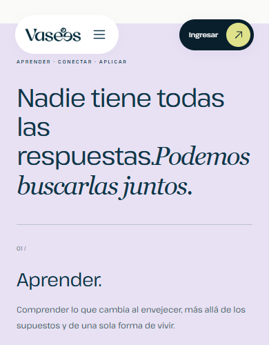
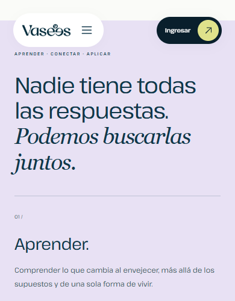
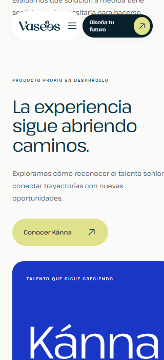
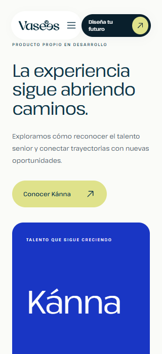
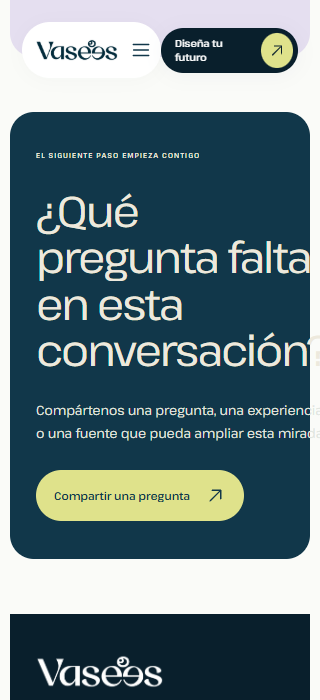
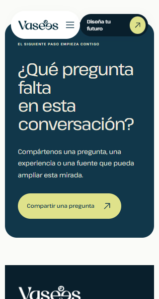
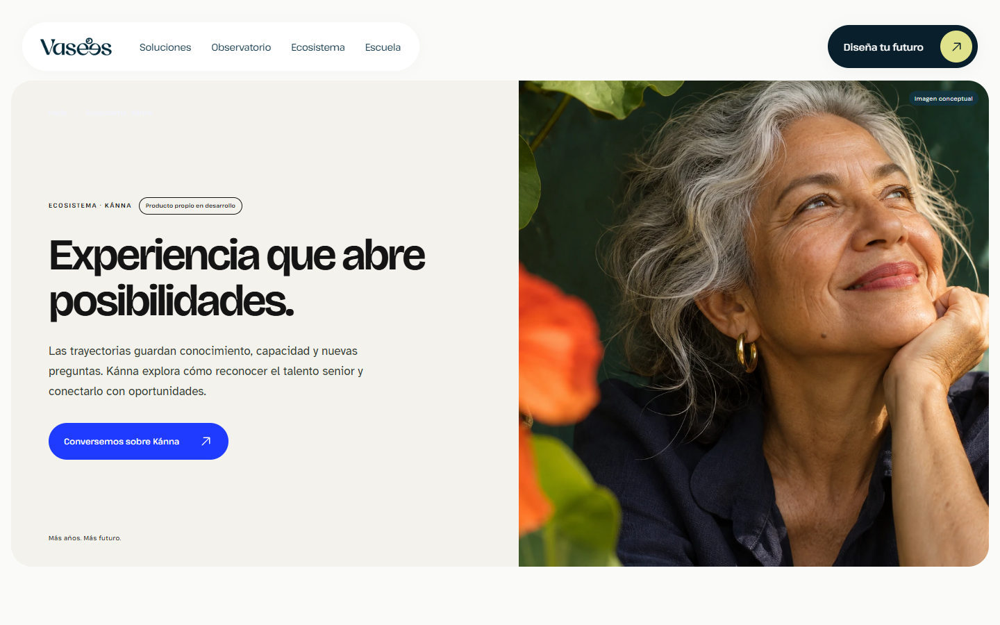
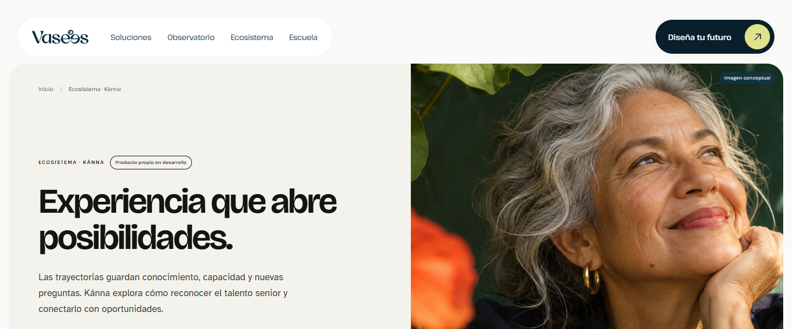
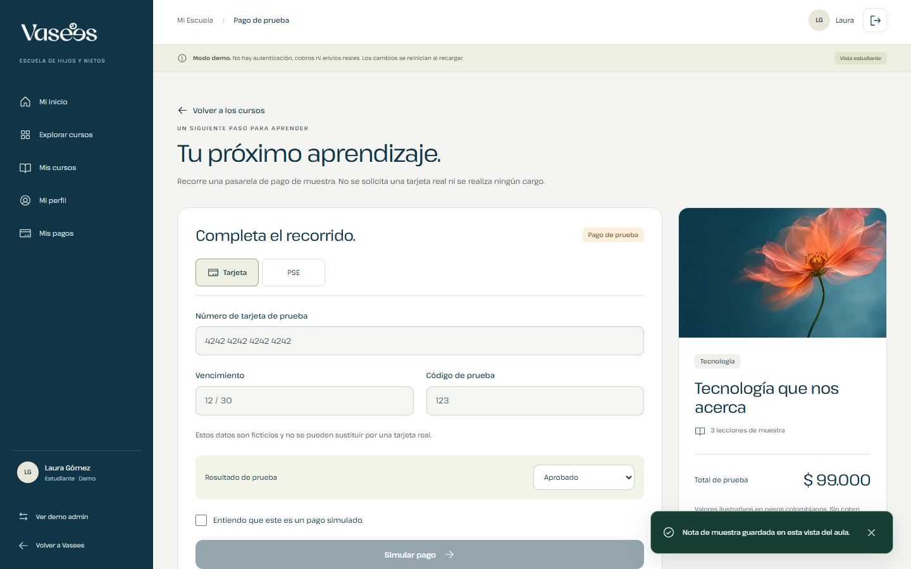
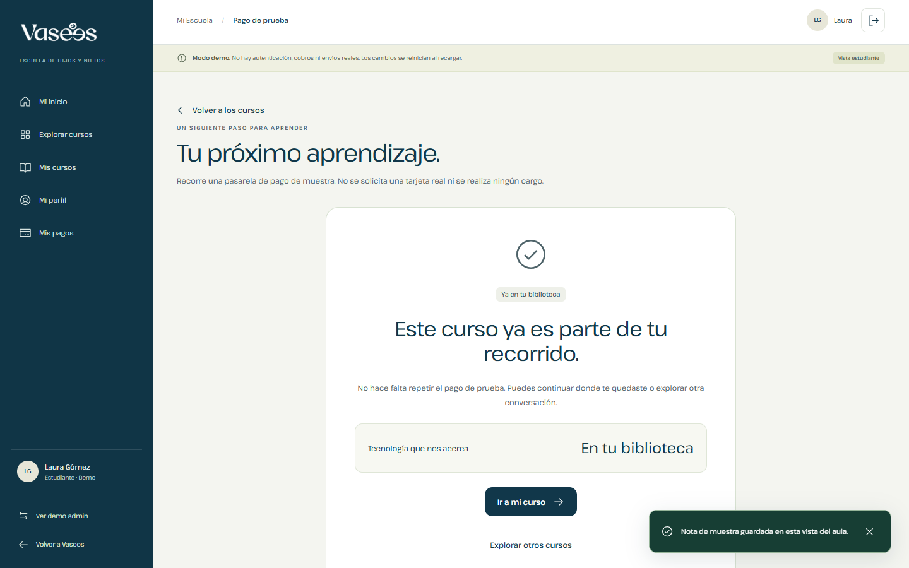

# Revisión de calidad · 16 de noviembre de 2026

Revisión de la web pública, la Escuela (estudiante) y el backoffice (administración) sobre la compilación de producción servida en local. Se conservan la dirección visual y el alcance de demostración: no se añadieron funciones, integraciones ni contenidos.

## Cómo se revisó

- **33 rutas × 4 anchos** (1440, 768, 390 y 320 px): desborde horizontal, errores de consola y de red, título y encabezado únicos; axe-core (WCAG 2.0/2.1/2.2 A y AA más buenas prácticas) en 1440 y 390 px.
- **108 estados autenticados** en 1440 y 390 px: acceso con código, catálogo, ficha, pago rechazado y aprobado, aula, perfil, pagos, cambio a administración, cursos (crear, duplicar, archivar, publicar), páginas, medios, personas, pagos, correos, ajustes y cierre de sesión. Cada estado con axe-core, consola y desborde.
- **Comprobaciones puntuales** del menú móvil con teclado y de las páginas 404 en un servidor estático que responde como Vercel (URL limpias y `404.html`).
- **Suites del repositorio**: `smoke`, `smoke:flower`, `smoke:pages`, `smoke:school`, `smoke:brands` y `smoke:podcast`.

## Hallazgos corregidos

| # | Área | Hallazgo | Corrección |
|---|---|---|---|
| 1 | Escuela · claridad | En móvil (≤580 px) el titular del enfoque se leía «respuestas.Podemos»: al ocultar el salto de línea se perdía el espacio. | Espacio antes del salto en `src/school.tsx`. |
| 2 | Responsive | A 320 px la página se desplazaba en horizontal y se recortaban textos en Inicio (cifras del Observatorio), Tech (titular, tarjeta Kánna y pasos), Observatorio (cierre) y Escuela (titular anterior). | Escalón `≤360px` para esos titulares y cifras en `styles.css` e `inner-pages.css`. Sin cambios por encima de 360 px. |
| 3 | Accesibilidad | En `/ecosistema/kanna` el breadcrumb era casi blanco sobre crema: ilegible (contraste AA fallido). | Tinta oscura para el breadcrumb del hero de Kánna en `brand-pages.css`. |
| 4 | Estudiante · funcional | Tras un pago aprobado, volver atrás permitía pagar otra vez el mismo curso y duplicaba la operación en «Mis pagos». | El pago detecta que el curso ya está en la biblioteca y ofrece ir al curso o explorar otros. |
| 5 | Navegación | Al abrir una vista privada sin sesión (por ejemplo `/escuela/perfil` o `/admin/usuarios`), el acceso llevaba siempre al inicio. | El acceso recuerda la vista solicitada, también al pasar por el código de 6 dígitos. |
| 6 | Navegación · 404 | Una URL inexistente bajo `/escuela/…` o `/admin/…` mostraba la pantalla de acceso con título «Página no encontrada» y un error de hidratación de React. | Esas URL muestran la página 404 pública, igual que el documento `404.html`. |
| 7 | Accesibilidad · teclado | El menú móvil público no se cerraba con Escape. | Escape lo cierra y devuelve el foco al botón del menú. |
| 8 | Accesibilidad | El enlace «Hay más por descubrir» tenía un nombre accesible distinto de su texto visible (WCAG 2.5.3). | Se elimina el `aria-label` redundante. |
| 9 | Accesibilidad · portal | El aviso de modo demo quedaba fuera de las regiones de la página; la barra lateral y los paneles laterales compartían región sin nombre; en catálogo y «Mis cursos» se saltaba de `h1` a `h3`. | Nombres para la barra lateral y el aviso; encabezado de nivel 2 solo para lectores de pantalla antes de las tarjetas. |
| 10 | Pruebas | Cinco suites no detectaban el servidor de vista previa cuando Vite colorea su salida, y `smoke:flower` fallaba en Windows por los finales de línea. | Detección tolerante a colores y `.gitattributes` con LF. |

## Capturas

| Hallazgo | Antes | Después |
|---|---|---|
| 1 · Titular de Escuela, 390 px |  |  |
| 2 · Tech, 320 px |  |  |
| 2 · Cierre de Observatorio, 320 px |  |  |
| 3 · Breadcrumb de Kánna, 1440 px |  |  |
| 4 · Pago de un curso ya adquirido |  |  |

Referencias del recorrido: [menú móvil](menu-movil-390.png), [inicio de estudiante en 390 px](estudiante-inicio-390.png) y [cursos en administración](admin-cursos-1440.png).

## Observaciones sin cambio

- **La Chispa**: las ocho fotografías de invitadas repiten su nombre en el texto alternativo y en el pie (aviso menor de buenas prácticas, no es un fallo AA). Se mantiene: es una decisión de contenido.
- **Curso gratuito sin inscripción**: si se llega al pago de prueba desde el aula, se muestra un pago de «Gratis». Es un borde del recorrido de demostración.
- **Peso del JavaScript**: un único archivo de 520 kB (143 kB comprimido). Dividirlo por rutas es una mejora de rendimiento fuera de este alcance.
- **Servidor de desarrollo**: en una carga directa el título de la pestaña tarda en actualizarse; la compilación de producción entrega el título correcto en las 33 rutas.
- `noindex, nofollow`, el estado en memoria y los avisos de demostración se conservan tal como están.

## Fuera del alcance de esta revisión

- No se revisó el despliegue publicado en Vercel ni la configuración del repositorio: la revisión se hizo sobre la compilación local de esta rama.
- No se probó con lectores de pantalla reales ni en dispositivos físicos; la accesibilidad se evaluó con axe-core, teclado y lectura del árbol de accesibilidad.
